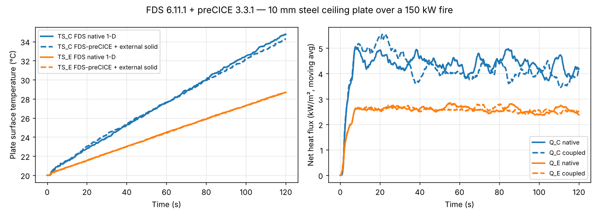

# FDS–preCICE adapter

Couples **FDS 6.11.1** to any structural/thermal solver through **preCICE 3.x**, for fire → structure thermal analysis (for example, steel and concrete elements heated by a fire computed in FDS).

FDS acts as the *fluid/fire* participant. On every WALL cell of the coupled SURF(s), at each FDS time step, it

- **writes** the net heat flux into the solid, in W/m²: `Q_CON_F + Q_RAD_IN − Q_RAD_OUT` (absorbed − emitted radiation + convection), and
- **reads** the solid surface temperature and imposes it as the wall temperature.

FDS keeps its own gas-phase convection and radiation models. The structural solver supplies only the surface temperature.

## Status (v0.1, 2026-11-09)

| Item | State |
|---|---|
| FDS 6.11.1, GNU + OpenMPI build | ✅ |
| preCICE 3.3.1 (Fortran bindings, no extra module needed) | ✅ |
| Multi-mesh / multi-MPI-process FDS | ✅ tested with 2 processes, coupled surface split across both meshes |
| `DIRICHLET` mode (write heat flux, read temperature) | ✅ validated (see below) |
| `ROBIN` mode (write sink temperature + HTC, read temperature) | ⚠️ implemented, not yet tested |
| Explicit coupling schemes (serial / parallel) | ✅ |
| Implicit coupling | ❌ not supported (would need FDS checkpointing) |
| Unstructured geometry (GEOM / CFACE) | ❌ only rectilinear OBST/VENT faces |
| FDS restart | ❌ |
| CalculiX partner (coupled temperature–displacement, thermal stress) | ✅ `tutorials/clamped-plate-calculix` (axial force within 1.3 % of hand check) |
| code_aster partner | ⏳ |

## How it works

- **Time stepping.** FDS sub-cycles inside each preCICE time window. Its time step is clipped so it never steps over a window end. The written data are **time-averaged over the window**, so the solid sees a smooth flux rather than an instantaneous LES sample.
- **Mesh.** The coupling mesh is the set of WALL cell centres of the coupled SURFs owned by each MPI process. preCICE handles the parallel partitioning and the mapping to the solid mesh.
- **Changes to FDS.** One new module (`src/prci.f90`) and a small patch (`patches/fds-6.11.1.patch`):
  - `type.f90`: adds `SURFACE%PRECICE_COUPLED`.
  - `wall.f90`: coupled SPECIFIED_TEMPERATURE surfaces keep the temperature imposed by the adapter.
  - `read.f90`: reads the `&PRCI` line.
  - `main.f90`: four hooks, for initialize, time-step limit, advance and finalize.
  - `Build/makefile`: adds the `ompi_gnu_linux_precice` target.

## Input

```fortran
&PRCI PARTICIPANT='Fluid', CONFIG_FILE='../precice-config.xml', MESH_NAME='Fluid-Mesh',
      SURF_ID='PLATE', COUPLING_MODE='DIRICHLET', TEMPERATURE_UNIT='K' /

&SURF ID='PLATE', TMP_FRONT=20., EMISSIVITY=0.9 /      ! TMP_FRONT = temperature until the solid sends one
&VENT XB=0.5,1.5,0.5,1.5,2.0,2.0, SURF_ID='PLATE' /
```

| Parameter | Default | Meaning |
|---|---|---|
| `PARTICIPANT` | `'Fluid'` | Participant name in the preCICE config |
| `CONFIG_FILE` | `'precice-config.xml'` | Path to the preCICE config |
| `MESH_NAME` | `'Fluid-Mesh'` | Mesh provided by FDS (3-D) |
| `SURF_ID(1:20)` | – | Coupled surfaces. They must be SPECIFIED_TEMPERATURE type, i.e. `TMP_FRONT` set and no `MATL_ID` |
| `COUPLING_MODE` | `'DIRICHLET'` | `'DIRICHLET'`: write heat flux, read temperature. `'ROBIN'`: write sink temperature + heat transfer coefficient, read temperature |
| `TEMPERATURE_UNIT` | `'K'` | `'K'` or `'C'` for the exchanged temperatures |
| `FLUX_INTO_SOLID_POSITIVE` | `.TRUE.` | Sign of the written heat flux |
| `FLUX_DATA_NAME`, `TEMPERATURE_DATA_NAME`, `SINK_TEMPERATURE_DATA_NAME`, `HTC_DATA_NAME` | `Heat-Flux`, `Temperature`, `Sink-Temperature`, `Heat-Transfer-Coefficient` | preCICE data names |

The coupling scheme must be `serial-explicit` or `parallel-explicit`. Use a `max-time` equal to FDS `T_END`. If preCICE ends the coupling first, FDS stops cleanly at that time.

## Build

```bash
sudo apt install gfortran libopenmpi-dev openmpi-bin   # + libprecice3 3.x package from github.com/precice/precice/releases
./build.sh            # -> bin/fds_precice   (clones FDS-6.11.1, applies the patch, builds)
```

## Validation: tutorials/ceiling-plate

A 2 × 2 × 2 m box open on two sides, with a 150 kW propane burner under a 1 × 1 m, 10 mm steel ceiling plate (insulated back). It uses two FDS meshes and 2 MPI processes, 100 coupled cells, a 0.5 s coupling window and serial-explicit coupling.

- **Coupled run:** FDS + `solid/solid_1d.py`, an independent 1-D implicit conduction model per surface vertex on a 0.05 m grid, with nearest-neighbour mapping.
- **Reference run:** FDS alone, with the same steel as a native thermally-thick SURF.

Surface temperature after 120 s:

| Point | FDS native | FDS–preCICE | Difference in temperature rise |
|---|---|---|---|
| Plate centre (`TS_C`) | 34.76 °C | 34.27 °C | −3.3 % (within LES fluctuation of the plume) |
| Plate edge (`TS_E`) | 28.68 °C | 28.68 °C | 0.0 % |



Run it with:

```bash
cd tutorials/ceiling-plate
pip install pyprecice
FDS_PRECICE=../../bin/fds_precice ./run.sh
```

## Next steps

1. ~~Couple to CalculiX~~ done: the flux sign convention is consistent (positive into the solid = CalculiX `*DFLUX`). Next: temperature-dependent elastic–plastic steel (EN 1993-1-2) and a real beam/column.
2. Test ROBIN mode, which suits radiation-dominated fires with large coupling windows.
3. Package as a cloudHPC app (FDS + preCICE + CalculiX in one container) and validate against a published fire–structure case.
4. Optional extras: CFACE (GEOM) support, and restart support.
